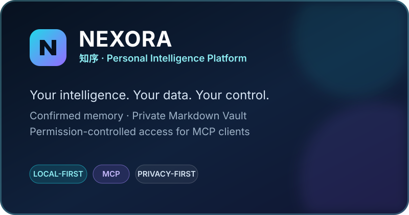
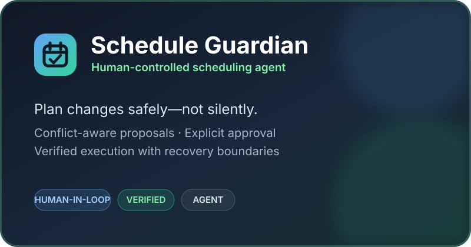

[**English**](README.md) · [简体中文](README.zh-CN.md) · [日本語](README.ja.md)

### AI Application Builder · Local-first Systems · Open Source Contributor

I build AI applications that **act, verify, and recover**— with a focus on local-first systems, agents, human control, and reliable execution.

## Focus

`AI Agents` · `Local-first` · `MCP` · `RAG` · `Human-in-the-loop` · `AI Security`

## Tech

  

## Featured Projects

- **[NEXORA / 知序](https://github.com/XY-code1/Nexora)** — An open-source, local-first personal intelligence platform with confirmed memory, a private Markdown Vault, and permission-controlled MCP access.
- **[Schedule Guardian](https://github.com/XY-code1/plan-guardian)** — A human-in-the-loop agent for conflict-aware, verified schedule changes.
- **[Accessible Beauty AI](https://github.com/XY-code1/accessible-beauty-ai)** — Real-time, accessible AI guidance for makeup practice.
- **[LvLing Travel Agent](https://github.com/XY-code1/LvLing-Travel-Agent)** — An AI travel agent and digital-human platform.

## Open Source Contributions / 开源贡献

### Recent merged contributions

- **[Tencent/teamai-cli](https://github.com/Tencent/teamai-cli)** — Added read-only session adapters for Pi / Oh My Pi ([#1586](https://github.com/Tencent/teamai-cli/pull/1586)), Muse Code ([#1680](https://github.com/Tencent/teamai-cli/pull/1680)), Hermes ([#1705](https://github.com/Tencent/teamai-cli/pull/1705)), and GitHub Copilot CLI ([#1785](https://github.com/Tencent/teamai-cli/pull/1785)); also preserved delivery records across equivalent HOME paths ([#1780](https://github.com/Tencent/teamai-cli/pull/1780)) and improved archive publication reliability ([#1327](https://github.com/Tencent/teamai-cli/pull/1327), [#1375](https://github.com/Tencent/teamai-cli/pull/1375), [#1382](https://github.com/Tencent/teamai-cli/pull/1382)).
- **[zalando-incubator/agentic-identity-broker](https://github.com/zalando-incubator/agentic-identity-broker)** — Added a dedicated, backward-compatible client-assertion audience for token exchange ([#283](https://github.com/zalando-incubator/agentic-identity-broker/pull/283)).
- **[Tencent/WeKnora](https://github.com/Tencent/WeKnora)** — Fixed CSV/TSV preview encoding detection by rejecting invalid UTF-8 before falling back to GBK ([#4479](https://github.com/Tencent/WeKnora/pull/4479)).
- **[morluto/rea](https://github.com/morluto/rea)** — Preserved the effective browser-bundle origin scope in generated evidence ([#4413](https://github.com/morluto/rea/pull/4413)) and isolated real CLI subprocess deadlines for clearer, more reliable Windows test diagnostics ([#5019](https://github.com/morluto/rea/pull/5019)).
- **[bytedance/deer-flow](https://github.com/bytedance/deer-flow)** — Preserved timezone offsets correctly when persisting run-event timestamps in SQLite ([#6894](https://github.com/bytedance/deer-flow/pull/6894)).

### In review

- **[Future AGI](https://github.com/future-agi/future-agi)** — Preserved picker-provided string provenance and routed JSON-/boolean-looking strings through a bounded Users matching walk ([#3786](https://github.com/future-agi/future-agi/pull/3786)).
- **[GitHub Advisory Database](https://github.com/github/advisory-database)** — Contributed evidence-backed advisory corrections and reference updates ([#10998](https://github.com/github/advisory-database/pull/10998), [#10999](https://github.com/github/advisory-database/pull/10999), [#11000](https://github.com/github/advisory-database/pull/11000)).
- **[OpenSSF Scorecard](https://github.com/ossf/scorecard)** — Updated GitLab merge-request analysis to use the latest returned commit date without reordering results ([#5339](https://github.com/ossf/scorecard/pull/5339)).

## GitHub Activity

  

**Build useful AI. Keep humans in control. Verify the result.**

